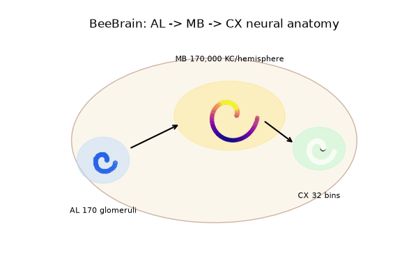
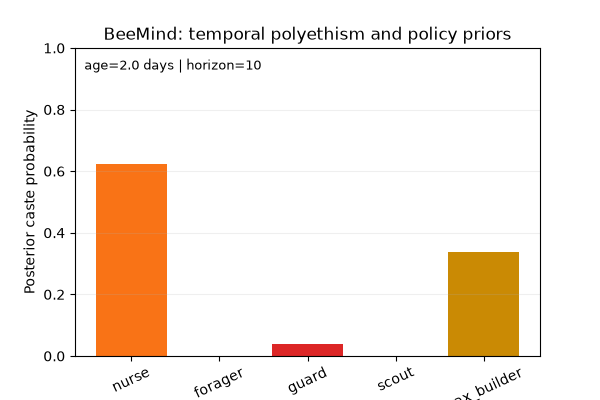
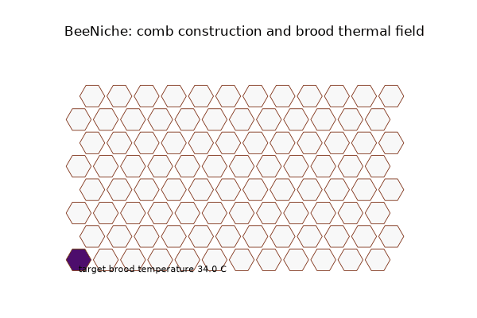
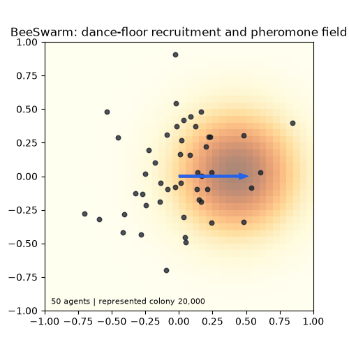
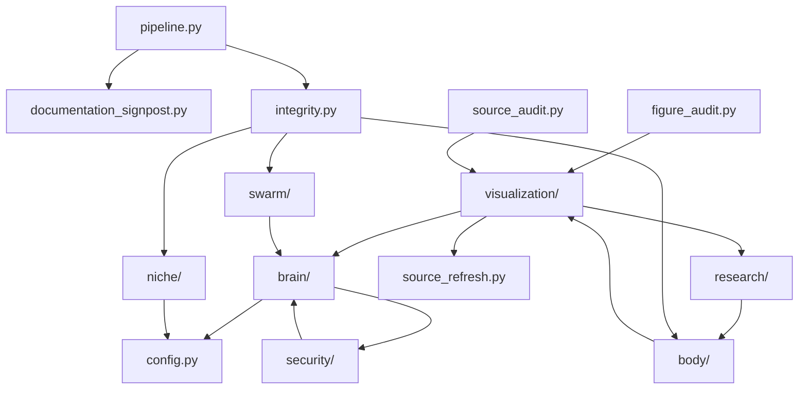

# BeeStack

<p align="center">
  <a href="https://github.com/docxology/BeeStack/actions/workflows/ci.yml"></a>
  <a href="LICENSE"></a>
  
</p>

<p align="center">
  
</p>

BeeStack is a uv-managed offline research CLI for reduced honeybee models and
declared multiscale interfaces, not a calibrated colony digital twin. Its typed layers are:

- `BeeBody`: FlyBody-backed walking and wing-beat flight rendering through
  FlyBody tasks, using a generated honeybee MJCF body plan.
- `BeeBrain`: reduced AL/MB/CX and waggle-decoding kernels, with availability-gated
  odor-template, calcium, antennal, follower, anatomy, and report methods.
- `BeeMind`: active-inference-style belief and policy selection with explicit
  diagnostics.
- `BeeSwarm`: dance recruitment, pheromone field, task allocation,
  BEEHAVE-compatible colony summaries, and strict FlyBody/MuJoCo multi-BeeBody
  3D waggle/collision scenes with contact reports.
- `BeeNiche`: comb, thermal, foraging-environment, Hiveopolis/BEEHAVE adapter,
  and nest metric kernels.

The project does not claim a complete honeybee simulator. The Body animation
path uses real [FlyBody](https://github.com/TuragaLab/flybody) tasks, and the
strict BeeBody and BeeSwarm FlyBody scenes hard-require FlyBody: the scripts
raise `FlyBodyUnavailableError` instead of falling back to reduced or Matplotlib
renderers when FlyBody is absent. BeeBrain downloads and analyzes curated public
honeybee anatomy/activity data when available. Mind, the swarm recruitment
kernel, and Niche are deterministic reduced kernels with clear contracts and
validation surfaces.
Strict BeeSwarm scenes reset scripted poses and measure MuJoCo geometry/contact
at those poses; they are not integrated forward-dynamics flight or colony simulations.
The reduced loop owns one immutable seeded PN-to-KC projection across ticks and
consumes required full-bearing `Observation.heading_deg` in degrees; angular
velocity remains radians/second. No empirical template bank is selected by default:
absent bank/condition measurements remain null, while actual observed zeros remain zero.
The driver uses a fixed synthetic dance, does not feed BrainState into policy or
niche context into Body, and does not retask agents from recruitment matches.
The graphical abstract distinguishes that executed scenario from declared interfaces.

The long-horizon digital-twin target is broader than the present scaffold:
a systems-biology model that assimilates observations for a managed colony and
for populations of interacting colonies. BeeStack now makes that target
auditable through `beestack.digital_twin`, `docs/digital_twin_path.md`, and
`output/data/digital_twin_readiness.json`; these artifacts name the missing
state variables, datasets, validation residuals, and governance boundaries
rather than treating the target as a present-tense result.

## The layers in motion

Committed renders from `output/animations/`. The FlyBody flight at the top replays scripted poses;
these four panels come from the deterministic reduced kernels described above, not calibrated colony behavior.

<table>
  <tr>
    <td align="center" width="50%"><br><sub><b>BeeBrain</b>: reduced AL → MB → CX anatomy</sub></td>
    <td align="center" width="50%"><br><sub><b>BeeMind</b>: temporal polyethism and policy priors</sub></td>
  </tr>
  <tr>
    <td align="center" width="50%"><br><sub><b>BeeNiche</b>: comb construction and brood thermal field</sub></td>
    <td align="center" width="50%"><br><sub><b>BeeSwarm</b>: dance-floor recruitment and pheromone field</sub></td>
  </tr>
</table>

## Reader Paths

| Need | Read | Run |
| --- | --- | --- |
| First successful local run | `README.md` quickstart | `uv run python scripts/analysis_pipeline.py` |
| Strict 3D waggle evidence | `docs/waggle_3d_scenario.md` | `uv run python scripts/verify_bee_render.py` |
| BeeBrain data provenance | `docs/beebrain_data_pipeline.md` | `uv run python scripts/analyze_empirical_bee_data.py` |
| Claim, source, and artifact audit | `docs/research_operations_playbook.md` | `uv run python scripts/audit_documentation.py` |
| Security posture and threat model | `docs/security_posture.md` | `uv run python scripts/run_security_audit.py` |
| Digital-twin target assessment | `docs/digital_twin_path.md` | `uv run python scripts/assess_digital_twin_readiness.py` |
| Manuscript editing | `docs/manuscript_development.md` | `uv run python scripts/z_generate_manuscript_variables.py` |
| Source-refresh ledger | `output/llm/source_refresh_ledger.md` | `uv run python scripts/write_source_refresh_ledger.py` |

## Quickstart

```bash
uv sync --locked --all-extras
uv run beestack-analysis --project-root .
uv run python scripts/z_generate_manuscript_variables.py
uv run python scripts/render_manuscript.py
uv run python scripts/verify_generated_reports.py
```

`scripts/fetch_empirical_bee_data.py` attempts curated acquisition by default.
Only completion-verified caches are skipped. Use `--metadata-only` for manifests;
large raw payloads stay under `output/data/empirical_sources/`, not package source.
If no workbook/CSV/MAT empirical panels are local, `scripts/analyze_empirical_bee_data.py`
is allowed to skip the optional empirical-analysis stage while the offline core
analysis, reports, signposting, and manuscript hydration continue.

Installed wheels provide `beestack-analysis --project-root /path/to/BeeStack`
and `beestack-animations --project-root /path/to/BeeStack`; they call package
APIs, not checkout-only scripts. The checkout owns canonical configuration/data
and every generated output. Skipped empirical stages preserve historical files
but invalidate current measurements through `output/data/empirical_availability.json`.

## Snapshot Policy

BeeStack uses a Full Snapshot policy for reproducibility. Track source, docs,
tests, manuscript sources, configs, generated reports, generated figures,
production GIFs, manifests, and lightweight JSON/Markdown data outputs. Exclude
dependency folders, caches, coverage files, local PDFs/slides/web exports, and
raw external empirical archives or large third-party payloads that can be
regenerated by `scripts/fetch_empirical_bee_data.py`. The `.gitignore` is
scoped to that policy so `output/reports/`, `output/figures/`,
`output/animations/`, and lightweight `output/data/*.json` remain visible.

## Full Verification

```bash
uv run ruff check src tests scripts
uv run ruff format --check src tests scripts
uv lock --check
uv run pytest --cov=src --cov-report=term-missing
uv run python scripts/fetch_empirical_bee_data.py --metadata-only
uv run python scripts/analyze_empirical_bee_data.py
uv run python scripts/analysis_pipeline.py
uv run python scripts/generate_animations.py
uv run python scripts/verify_bee_render.py
uv run python scripts/review_stack_integrity.py
uv run python scripts/run_research_suite.py --assemble-only
uv run python scripts/run_methods_analysis.py
uv run python scripts/run_stack_synthesis.py
uv run python scripts/assess_digital_twin_readiness.py
uv run python scripts/z_generate_manuscript_variables.py
uv run python scripts/render_manuscript.py  # bootstrap PDF for cold-checkout audits
uv run python scripts/signpost_project_tree.py
uv run python scripts/audit_documentation.py
uv run python scripts/run_security_audit.py
uv run python scripts/signpost_project_tree.py --check
# Audits update manuscript inputs: hydrate and seal the final PDF afterwards.
uv run python scripts/z_generate_manuscript_variables.py
uv run python scripts/render_manuscript.py
uv run python scripts/verify_generated_reports.py
uv run python scripts/audit_publication_readiness.py --check
```

## Release 2.0 candidate

Version authority: `src/beestack/version.py`; package metadata is `2.0.0` and
`docs/manuscript/config.yaml` declares manuscript `2.0`. This is a major API
cutover: required full-bearing heading/model connectivity, explicit missing
empirical values, root-aware provenance, and verified download-completion records.
Python support is >=3.11,<3.13; the development/CI pin is 3.12.16.

Publication gate (after full verification above):

```bash
uv run python scripts/audit_publication_readiness.py --check
# strict deposit check:
uv run python scripts/audit_publication_readiness.py --check --require-doi
```

Combined PDF: `output/pdf/BeeStack_combined.pdf`, generated **inside this checkout**
by `uv run python scripts/render_manuscript.py` using Pandoc and XeLaTeX.
The gate requires a real readable PDF and a matching source/data/figure render
receipt. All supported Markdown image references and sidecars are sealed, regardless
of image format or project-local folder. No sibling template checkout is used.
Core primary figures remain mandatory. Every production manuscript image requires
an exact curated registry path and matching caption/label, not an indexed fallback.
Empirical primary figures require current, data-bound analysis; retained historical
empirical images are rejected from the manuscript.
`10.5281/zenodo.20420557` identifies the [historical 1.0 deposit](https://zenodo.org/records/20420557),
not 2.0; the new `publication.doi` stays empty until a version-specific DOI is assigned.
Strict deposit admission rejects empty/malformed and known historical DOIs; offline
shape/history checks do not verify assignment of an unknown DOI. Never reuse the
older DOI. See `CHANGELOG.md` for contracts and limitations.

Empirical intake requires complete observed channel/condition grids and explicit,
consistent acquisition rates; it never fills absent observations with zeros or
invented sampling rates. Published signed-rank statistics retain fractional ranks.
Current empirical evidence is bound to raw payloads, configuration and implementation;
parsing a published supplement is not connectivity or biological validation.
Download completion also binds the original locator, source DOI/version and advertised
size. Legacy byte-only receipts cannot certify a different source after a failed refresh.
Acquisition and container parsers apply explicit byte, expansion, workbook, and
array/graph budgets before materialization. Policy rejection is not a successful
empty parse; see `docs/security_posture.md` for the bounded-intake contract.
Current local odor, calcium, and antennal payloads are absent. Standalone waggle
CSVs and Table S1 statistics are separate evidence, not a current odor-conditioned
aggregate. Figure sidecars retain provenance and availability; `_data.json` plot
payloads preserve nullable observations and independent native units.
Unavailable numeric witnesses fail their configured checks without leaving the
denominator; raw methods plots and hydrated prose preserve gaps rather than
turning boolean/nonfinite values into measurements. Actual zero remains observed.
All GIF writers share cumulative-centisecond timing: integer FPS in 1..100,
encoded boundary error at most 5 ms, distinct from physics and viewer scheduling.

BeeStack is MIT licensed (`LICENSE`). Vendored/generated FlyBody assets retain their
upstream Apache-2.0 notice; source datasets retain their own registered licenses.

## Output Map

- `output/data/model_card.json`: configuration, contracts, empirical registries,
  and reproducibility metadata.
- `output/data/task_allocation.json`: deterministic task-allocation snapshot
  written unconditionally by `scripts/analysis_pipeline.py` from the simulation
  result.
- `output/data/research_suite_report.json`: unified method scorecards,
  visualization inventory, empirical evidence, sensitivity sweeps, and gaps.
- `output/data/methods_analysis.json`: science-first per-module methods panels,
  validation panels, scenario sweep summaries, manuscript evidence links, a
  source-claim crosswalk with citation keys/DOIs, and top validation gaps.
- `output/data/stack_synthesis_review.json`: cross-stack statistical synthesis
  of module readiness, simulation telemetry, visualization evidence,
  signposting, empirical parseability, and scholarship anchors.
- `output/data/digital_twin_readiness.json`: machine-readable assessment of
  requirements, maturity, blockers, and next artifacts for the full
  systems-biology colony and population-of-colonies digital-twin target.
- `output/data/manuscript_figure_index.json`: manuscript-oriented figure and
  artifact provenance index with captions, alt text, claim tiers, unsupported
  inference boundaries, sidecar validation status, repo-relative artifact
  paths, and regeneration commands.
- `output/llm/source_refresh_ledger.json`: Perplexity/web discovery notes after
  direct scholarly or official verification, with citation keys, DOIs/source
  URLs, availability state, section targets, figure targets, and claim tiers.
- `output/data/sensitivity/`: deterministic reduced-kernel sensitivity sweep
  payloads.
- `output/data/empirical_sources/`: downloaded Dryad and Honeybee Standard Brain
  payloads plus Figshare waggle-following CSVs, `catalog.json`,
  `archives.json`, and `anatomy_downloads.json`.
- `output/figures/empirical/`: empirical panel, activity, antennal, waggle
  follower, data-completeness, anatomy asset/projection, and neuropil coverage
  figures.
- `output/figures/`: module diagnostics and whole-stack showcase schematics,
  including the BeeStack graphical abstract, contract network, scale ladder,
  evidence ladder, source-refresh matrix, micro-to-macro calibration map,
  anatomy-policy map, niche adapter map, validation-readiness panel, and
  pipeline overview.
- `output/figures/research/`: science-first scorecard, sensitivity, empirical
  completeness, module diagnostics, and evidence-network figures.
- `output/figures/methods/`: module methods dashboards for Body, Brain, Mind,
  Swarm, Niche, plus a repo-wide methods dashboard and manuscript evidence
  index.
- `output/interactive/`: optional Plotly HTML research-suite views.
- `output/animations/`: FlyBody BeeBody GIFs and strict FlyBody/MuJoCo
  BeeSwarm ten-bee collision, short configured waggle, and long multi-BeeBody
  waggle-dance GIFs that hard-fail without FlyBody, plus reduced Brain, Mind,
  swarm-recruitment, and Niche animations.
- `output/animations/flybody_scenes/`: generated multi-bee MJCF scene XMLs,
  copied BeeBody body-plan assets, contact metrics, and scene provenance.
- `output/data/waggle_dance_visualization_config.json`: decoded waggle-dance
  duration, angle, sun azimuth, distance, quality, and follower settings.
- `output/reports/flybody_contact_physics.md`: MuJoCo contact evidence for the
  BeeSwarm production collision, configured waggle, and long waggle scenes.
- `output/reports/beestack_research_report.md`: central research report with
  method scorecards, validation fractions, visual inventory, empirical
  registry/evidence rows, evidence availability states, sensitivity sweeps, and
  known gaps.
- `output/reports/methods_analysis.md`: science-first methods report linking
  per-module diagnostics, visualizations, validations, manuscript claims, and
  explicit evidence availability states, source DOIs, and claim tiers.
- `output/reports/stack_synthesis_review.md`: synthesized statistical review
  tying module scorecards, simulation records, artifacts, signposting, and
  manuscript scholarship into one auditable surface.
- `output/reports/manuscript_figure_index.md`: backend/fidelity/source/command
  index for manuscript figures and cited visual artifacts.
- `output/reports/project_readiness_review.md`: strict directory signposting,
  documentation-audit health, research gaps, and prioritized next improvements.
- `output/reports/beestack_integrity_review.md`: module APIs, contracts,
  diagnostics, validation records, fidelity levels, and gaps.
- `output/reports/documentation_audit.md`: documentation freshness, figure
  reference, fidelity claim, citation-key, BibTeX DOI/URL, source-registry, and
  conservative digital-twin language audit.
- `output/reports/generated_report_audit.md`: generated-report freshness and
  semantic audit for stale local reports, missing current evidence paths,
  missing evidence-link citation metadata, and unsupported support claims.
- `output/manuscript/`: manuscript sections with variables resolved.

Network-gated empirical analysis adds these artifacts only when the relevant
public payloads are local and parseable: `output/data/empirical_analysis.json`,
`output/data/empirical_template_bank.json`,
`output/data/bee_brain_end_to_end_report.json`,
`output/data/waggle_follower_analysis.json`,
`output/data/brain_data_completeness.json`,
`output/reports/empirical_analysis.md`,
`output/reports/waggle_follower_analysis.md`, and empirical figures under
`output/figures/empirical/`. Their absence in an offline core run is a recorded
data-availability state, not a license to invent replacement values.

## Project Layout

```text
src/beestack/      Typed contracts, domain kernels, anatomy/activity parsers
tests/             Unit and integration tests with a 92% source coverage gate
scripts/           Thin orchestration scripts for downloads, analysis, reports
docs/              Architecture, runbooks, API, validation, and output guides
docs/manuscript/        Template-renderable paper sections and bibliography
output/            Regeneratable artifacts and raw empirical downloads
```

Every non-cache project directory has `README.md` and `AGENTS.md` guidance for
future agents. `scripts/signpost_project_tree.py` regenerates missing signposts
for generated FlyBody assets, empirical dataset leaves, diagnostic folders, LLM
audit evidence, logs, simulation exports, and local export leaves. Cache
directories such as `.uv-cache/`, `.mypy_cache/`, `.pytest_cache/`,
`.ruff_cache/`, `__pycache__/`, and `*.egg-info` are deliberately excluded.

### Package map

Generated on 2026-11-12 from the `import` statements under `src/beestack/`. An arrow from A to B means code in A imports B; arrows already implied by a longer path are left out, so the picture shows layering rather than every edge. It shows 14 of the package's 28 top-level parts: the largest ones that import or are imported by others.



## Empirical BeeBrain Scope

The curated BeeBrain registry covers:

- [Virtual Honeybee Standard Brain](https://www.bcp.fu-berlin.de/en/biologie/arbeitsgruppen/neurobiologie/ag_menzel/beebrain/index.html)
  gray-value images, label-field TIFFs, VRML atlas/neuron/tract assets, and
  neuropil abbreviation metadata.
- Paoli 2024 Dryad antennal-lobe calcium `.mat` payloads.
- Carcaud 2022 multisite GCaMP workbooks across AL, LH, and MB calyx regions.
- Andreu 2025 odorant-receptor alarm-pheromone workbooks.
- Jernigan 2026 antennal active-sensing CSV files.
- Nouvian 2017/2018 Dryad brain biogenic-amine and defence spreadsheets.
- [Hadjitofi & Webb 2024 Figshare waggle-following data](https://figshare.com/articles/dataset/Honeybee_antennal_positioning_data_when_following_dances/24715977):
  CC BY 4.0 follower positions, antennal angles, binned features, and model
  error CSVs for dance-vector decoding, paired with their Current Biology
  antennal-positioning article DOI `10.1016/j.cub.2024.02.045`.

Unavailable upstream files are reported as gaps, not silently invented. For
example, Dryad archive endpoints may reject some large archives; the fetcher
then records the error and attempts file-level downloads where the catalog
exposes URLs.

The current empirical readiness gate uses the configured
`research.empirical_completeness_threshold` from `docs/manuscript/config.yaml`
(`0.5` in this checkout). BeeStack also records every registered-but-not-local
or nonparseable source with DOI/source verification, parser status, blocker,
and remediation path in `output/data/brain_data_completeness.json`. A stricter
`0.800` parseability target remains an improvement target, not a satisfied
current result.

## Documentation

Start with `docs/README.md`, then use:

- `docs/beebrain_data_pipeline.md` for provenance, download, parse, analyze, and
  report flow.
- `docs/data_acquisition_runbook.md` for operational data-fetch guidance.
- `docs/api_reference.md` for the public typed records and functions.
- `docs/generated_outputs.md` for artifact paths.
- `docs/baseline_readiness.md` for current readiness gates and tracked
  follow-ups.
- `docs/visualization_gallery.md` for every GIF/figure/report, its backend,
  fidelity level, source data, regeneration command, and validation status.
- `docs/validation_criteria.md` for acceptance criteria.
- `docs/troubleshooting.md` for common failures.

The historical project specification is summarized in `docs/spec_review.md`;
current claims are governed by generated reports under `output/reports/` plus
the offline source audit embedded in `output/reports/documentation_audit.md`.
